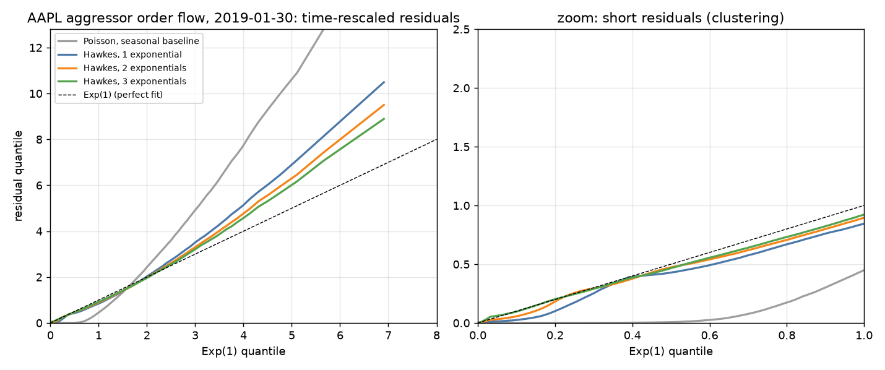

# hawkesflow

**Hawkes-process models of NASDAQ order flow.** Bivariate (buy/sell) Hawkes processes with
sum-of-exponentials kernels and an intraday-seasonal baseline. They are fitted by maximum
likelihood with an analytic O(n) gradient (Numba), tested by time rescaling, and validated by
simulation, on aggressor-signed executions from the NASDAQ TotalView-ITCH sample.

[](https://github.com/eshaan2418/hawkesflow/actions/workflows/ci.yml)

> Educational/research project. Not investment advice. No live trading.



## Headline results
2019-01-30, 09:30–16:00, six liquid NASDAQ names, displayed executions signed by aggressor.
Numbers come from [`itch_fits.json`](research/results/itch_fits.json),
[`coverage.json`](research/results/coverage.json) and [`bench.json`](bench/results/bench.json).

| symbol | executions | aggressive orders (collapsed) | KS: seasonal Poisson | KS: Hawkes 1 / 2 / 3 exp | **endogeneity ρ** (2 exp) | ρ uncollapsed | timescales (2 exp) | self / cross excitation |
|---|---|---|---|---|---|---|---|---|
| AAPL | 85,757 | 52,954 | 0.435 | 0.094 / 0.044 / 0.033 | **0.53** | 0.67 | 0.24 ms, 7.8 ms | 0.47 / 0.07 |
| MSFT | 63,222 | 31,382 | 0.382 | 0.077 / 0.040 / 0.028 | **0.51** | 0.70 | 0.31 ms, 23 ms | 0.41 / 0.09 |
| AMZN | 29,310 | 19,799 | 0.548 | 0.111 / 0.062 / 0.051 | **0.61** | 0.68 | 0.22 ms, 15 ms | 0.59 / 0.04 |
| NVDA | 60,906 | 35,698 | 0.504 | 0.117 / 0.067 / 0.039 | **0.57** | 0.72 | 0.24 ms, 6.1 ms | 0.51 / 0.05 |
| TSLA | 30,471 | 22,300 | 0.569 | 0.119 / 0.086 / 0.051 | **0.65** | 0.68 | 0.25 ms, 19 ms | 0.61 / 0.06 |
| QQQ | 53,841 | 29,158 | 0.331 | 0.077 / 0.035 / 0.014 | **0.41** | 0.65 | 0.18 ms, 9.1 ms | 0.33 / 0.08 |

- **Order flow is self-exciting.** Even with a half-hourly baseline, Poisson residuals are far
  from Exp(1) (KS 0.33–0.57). Hawkes models cut that to 0.014–0.051.
- **About half of aggressive orders are responses to earlier ones.** The branching spectral
  radius is 0.41–0.65.
- **Several timescales at once.** Each added exponential lowers BIC for every symbol (best:
  3 components, from ~50 µs to seconds), the signature of a heavy-tailed kernel.
- **Buys excite buys, sells excite sells.** Cross-excitation is 0.04–0.09.
- **The fragmentation trap.** One aggressive order prints several same-nanosecond executions
  (38% of AAPL's are fragments). On raw prints the likelihood has *no maximum* (β → ∞). With β
  capped, measured endogeneity is inflated to 0.65–0.72.
- **The estimator is calibrated.** On 40 simulated AAPL-sized days, 95% intervals cover 94.75%
  (kernel) and 95.5% (baseline); ρ is recovered as 0.5277 ± 0.0025 against a true 0.5283.
- **Fast.** One fit (52,961 events, 36 parameters) takes **0.15 s** with the analytic gradient,
  against 5.7 s with finite differences. The likelihood plus gradient takes 1.8 ms.

## Model
λ_k(t) = μ_k(half-hour bin) + Σ_j Σ_p α[k,j,p]·β_p·Σ_{past type-j events} e^{−β_p(t−t_m)}.
- **Likelihood and gradient** come from a single O(n·D·P) recursion. The β-derivative uses
  S ← e^{−βΔt}(S − Δt·R).
- **Fitting** is L-BFGS-B on log-parameters. Standard errors come from the observed information.
- **Goodness of fit** uses compensator increments, which are iid Exp(1) under the right model.
- **Simulation** uses Ogata thinning.

Details: [DESIGN](docs/DESIGN.md).

## Run it
```bash
make build test lint       # likelihood vs O(n^2) brute force, analytic gradient vs FD, recovery, residuals, seasonality
make data                  # signed executions from the ITCH sample (via tickstore's export)
make research              # fits for 6 symbols, Monte Carlo coverage, Q-Q plot
make bench demo
```
```python
import numpy as np
from hawkesflow import HawkesSpec, fit, simulate, compensator_residuals
spec = HawkesSpec(D=2, P=2, bins=np.linspace(0, 23400, 14))
r = fit(spec, t, k, beta0=[100.0, 1.0])          # t: seconds, k: 0 buy / 1 sell
r["branching"], r["spectral_radius"], 1 / r["beta"]
```

Real output (`make demo`; [`demo_output.txt`](research/results/demo_output.txt)):
```
AAPL 85757 52954 KS pois 0.435 KS h2 0.044 rho h2 0.528 rho raw 0.669 ts [0.0002, 0.0078] 1 s
```

## Documentation
- [docs/DESIGN.md](docs/DESIGN.md): model, recursion, gradient, fitting, time rescaling,
  simultaneous events
- [docs/MICROSTRUCTURE.md](docs/MICROSTRUCTURE.md): why order flow clusters, timescales, the
  fragmentation trap
- [docs/DEEP_DIVE.md](docs/DEEP_DIVE.md): 12 interview-style questions and answers
- [docs/PERF_LOG.md](docs/PERF_LOG.md): the 37× analytic-gradient speed-up and the fixes

## Where it fits
- **Data path.** The data comes from [itchbook](https://github.com/eshaan2418/itchbook)'s feed
  through [tickstore](https://github.com/eshaan2418/tickstore)'s columnar store.
- **Complements.** [queuesim](https://github.com/eshaan2418/queuesim) (queue-aware fills) and
  [sorx](https://github.com/eshaan2418/sorx) (execution): a fitted intensity is a short-horizon
  forecast of activity.

## Data
NASDAQ TotalView-ITCH 5.0 sample `01302019.NASDAQ_ITCH50.gz` (public sample data). The derived
event files are produced by `make data` and are not redistributed. CI runs on simulated data.

## License
MIT.
